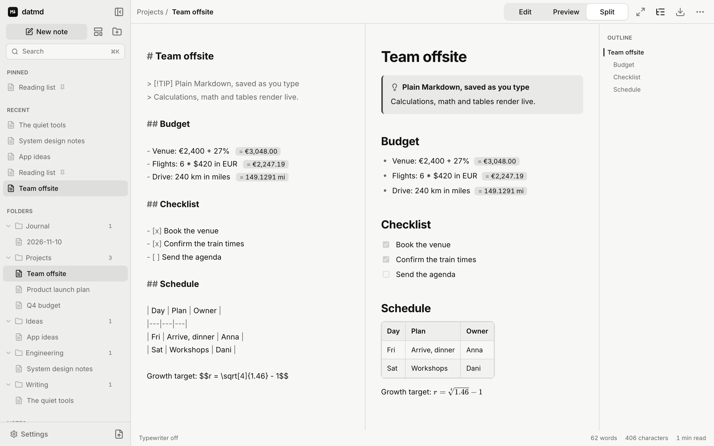

<div align="center">


# datmd

**Write in Markdown. Think in peace.**

A calm, local-first Markdown editor for the web that saves as you type, does the math for you, and keeps your notes on your device.

<br>

<picture>
  <source media="(prefers-color-scheme: dark)" srcset="./src/assets/screenshots/readme-dark.webp" />
  
</picture>

</div>

## ✨ Key Features

- **✍️ Three Ways to Write**: Choose Edit, Preview or Split (⌘1 · ⌘2 · ⌘3). In Split view, the preview follows the editor as you scroll.
- **🗂️ Calm Organisation**: Folders, pinned notes and recent notes in one collapsible sidebar. Drag and drop notes to reorder them or move them between folders. Folders can be created, renamed and deleted inline. Deleting a folder moves its notes to *Notes* and never deletes your writing.
- **🔍 Instant Search**: Press ⌘K to search titles and full text across every note. Matching ignores case and accents, results show highlighted matches with context, and you can move through them with the arrow keys and Enter.
- **🧭 Live Outline**: The headings of the current note appear in a side panel. Click one to jump there; the section you're reading stays highlighted as you scroll.
- **🧘 Focus & Typewriter Modes**: Focus mode (⌘⇧F) hides everything except the page. Typewriter mode (⌘⌥T) keeps the line you're writing vertically centred.
- **🧮 Inline Calculations**: Write `20% of 150`, `5 km in miles`, `$30 in EUR`, `sqrt(16)` or `255 in hex` on its own line, and the answer appears beside it in both the editor and the preview. Supported:
  - arithmetic, percentages (`150 + 10%`, `20% off 80`) and functions
  - length, weight, volume, time, temperature and data-size units
  - about 30 currencies, using European Central Bank rates
  - hex, binary and octal output
  - labelled lines like `Rent: $1200 + $300`
- **📐 Complete Markdown**: GitHub-flavoured tables, task lists, footnotes and strikethrough, plus:
  - syntax highlighting for 35+ languages
  - KaTeX math, inline `$$…$$` and display blocks
  - Mermaid diagrams
  - callouts: `> [!NOTE]`, `[!TIP]`, `[!IMPORTANT]`, `[!WARNING]` and `[!CAUTION]`
- **⌨️ Keyboard-First Editing**: Shortcuts for bold, italic, strikethrough, inline code, links, headings, lists, task lists, quotes and code blocks. Type `/` at the start of a line for an insert menu, or ` ``` ` for language suggestions. Lists continue when you press Enter.
- **📝 Templates**: Start from a Daily Note, Meeting Notes, Journal, Project Planning, Article or Simple Document template. Templates that need a date fill in today's.
- **📊 Word Count**: A quiet status bar shows words, characters and reading time.
- **📤 Export Anywhere**: Export a single note as:
  - **Markdown**: the plain-text original
  - **HTML**: a standalone, styled web page
  - **PDF**: print-quality typography with proper page breaks
  - **Word (.docx)**: headings, lists, tables and real footnotes

  You can also export your whole library as a `.zip`, with folders included. Import `.md` files or a `.zip` by drag and drop.
- **🎛️ Make It Yours**: Settings for light, dark or system theme, writing font (sans, serif or mono), text size, line height, text width, default view and save delay. A full keyboard shortcut reference is built in.
- **📱 Designed for Phones Too**: On small screens, notes open from a drawer, the editor switches to a single view, and controls are sized for touch. It isn't a shrunken desktop layout.
- **🌟 Premium Minimal UI**: Built on [datui](https://datui.vercel.app/docs), with typography-first surfaces, neutral tones, subtle motion and WCAG AA contrast in both themes.

## 🛠️ Technology Stack

- **Framework**: [Next.js 16 (App Router)](https://nextjs.org/), fully static output
- **Runtime & View Library**: [React 19](https://react.dev/)
- **Styling**: [Tailwind CSS v4](https://tailwindcss.com/) with [datui](https://datui.vercel.app/docs) components
- **Editor**: [CodeMirror 6](https://codemirror.net/)
- **Markdown Pipeline**: [unified](https://unifiedjs.com/), using [remark](https://github.com/remarkjs/remark) and [rehype](https://github.com/rehypejs/rehype) with GFM, sanitising and [highlight.js](https://highlightjs.org/)
- **Math & Diagrams**: [KaTeX](https://katex.org/) and [Mermaid](https://mermaid.js.org/)
- **Storage**: IndexedDB through [Dexie](https://dexie.org/)
- **Export**: [docx](https://docx.js.org/) for Word and [fflate](https://github.com/101arrowz/fflate) for zip
- **Exchange Rates**: [Frankfurter](https://frankfurter.dev/), which serves European Central Bank reference rates
- **Type Safety**: [TypeScript](https://www.typescriptlang.org/) (strict)
- **Icons**: [Lucide React](https://lucide.dev/)
- **Testing**: [Vitest](https://vitest.dev/) with [fake-indexeddb](https://github.com/dumbmatter/fakeIndexedDB)
- **Hosting**: [Vercel](https://vercel.com/) Hobby, with no serverless functions, database or environment variables

## 📈 How It Thinks

### Saving
- Notes are written to IndexedDB about 400 ms after you stop typing. Settings can change the pause to 1 s or 3 s, and ⌘S always saves immediately.
- Pending text is also saved when you switch notes, hide the tab or close the page. If a write is still waiting when you close the tab, the browser asks you to confirm leaving.
- A failed write never drops text. The newest version is kept and retried, and the header says *Not saved · retrying* until it succeeds.

### Calculations
- **Display only.** Results are drawn beside the line and never written into your note. Exports contain your text without them.
- **No `eval`, ever.** Expressions go through a purpose-built tokenizer and recursive-descent parser. Anything it doesn't understand simply isn't a calculation.
- **Prose stays prose.** A line only counts as a calculation when it actually computes something. Bare numbers, dates (`2026-11-10`), ranges and phone numbers (`555-1234`) and version strings (`1.2.3`) are left alone.
- **Money is money.** A single `$` means dollars, never the start of a formula, so `$2,400 + $1,020` is a sum. Inline math uses `$$…$$`.
- **No guessing on currencies.** Rates are fetched only when a note converts between currencies and cached for 12 hours. Offline, cached rates keep working. If there are no rates at all, the line says *rates unavailable* instead of showing a wrong number.

### Rendering
- The preview re-renders a moment after you type. Diagrams are cached, so they don't flicker while you write.
- KaTeX, highlight.js, the Word exporter and Mermaid load only when you first need them, so the editor opens fast.

## ⚖️ Privacy & Security

### Your Notes
- There's no sign-up and no login. Open the page and write.
- Notes live only in your browser's IndexedDB. There is no server-side database, and nothing you write is uploaded.
- Everything is plain Markdown. Export one note or the whole library at any time.
- Because notes live in one browser, clearing site data removes them. Export a backup now and then.

### Network
- **No analytics, no third-party scripts, no cookies.**
- The only request datmd makes on its own fetches exchange rates from Frankfurter. It happens only when a note converts currencies, and it carries no information about you or your notes.
- HTML exports that contain math link KaTeX's stylesheet from a CDN, so formulas are styled when you open the file.

### Untrusted Content
- Imported files are treated as untrusted. Raw HTML is dropped, and every rendered note is sanitised, so `javascript:` links and event handlers never run.
- Mermaid renders in strict security mode.
- Zip imports refuse oversized archives, with limits per file, in total and on file count, to guard against zip bombs.

<br>

> **Your notes, your device.** datmd stores everything locally in your browser. It's fast and private, and it means you're responsible for backups. Use **Settings → Export all as .zip** to keep a copy.

<br>

**Made with love for love. 🤍**  
*Write in Markdown. Think in peace.*
